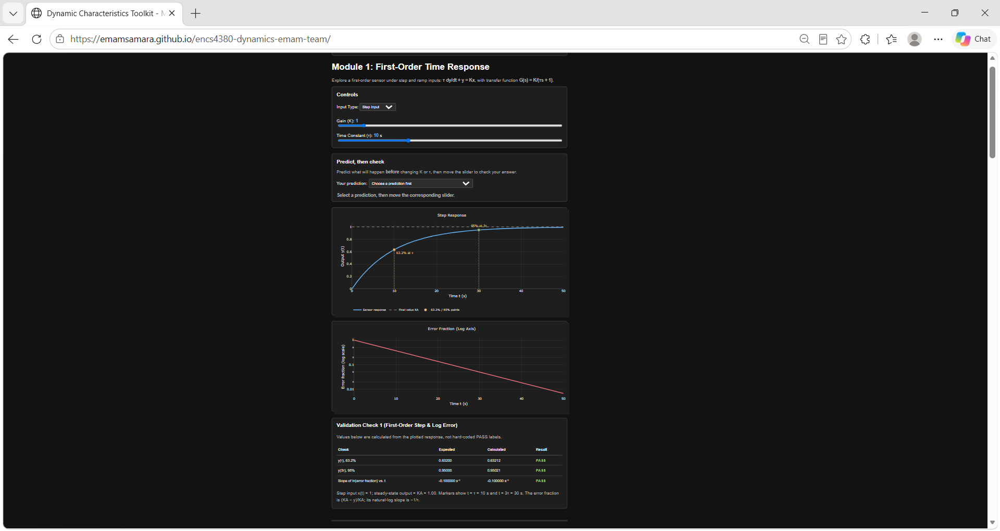
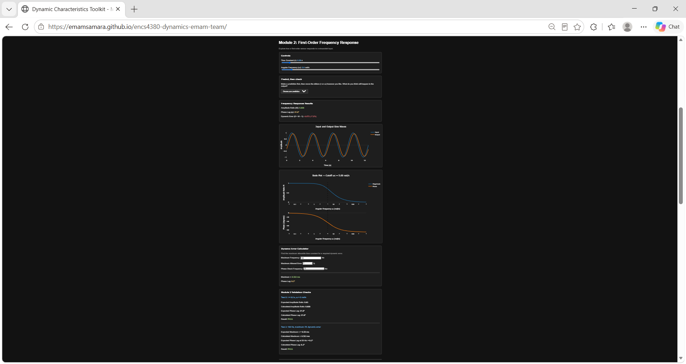
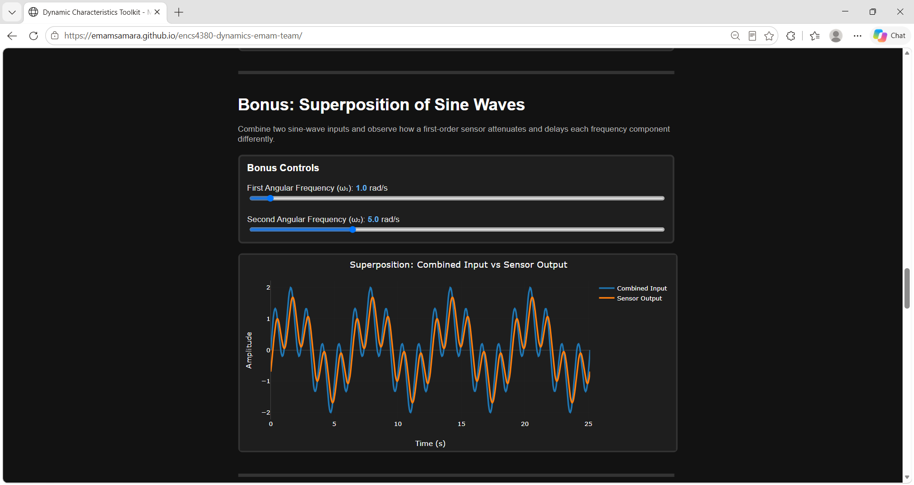
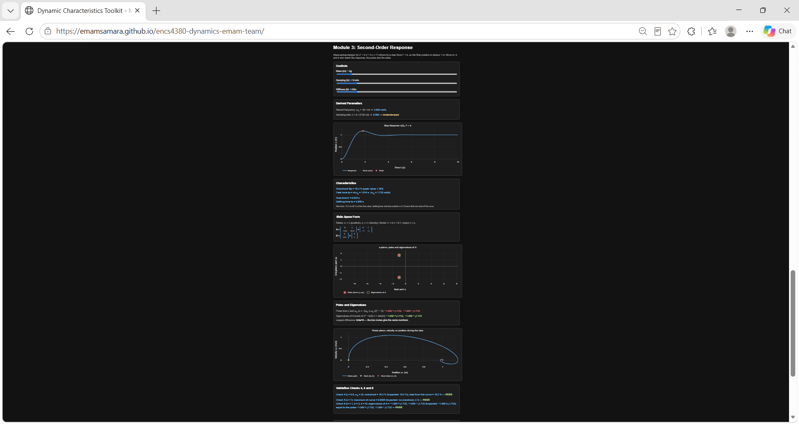
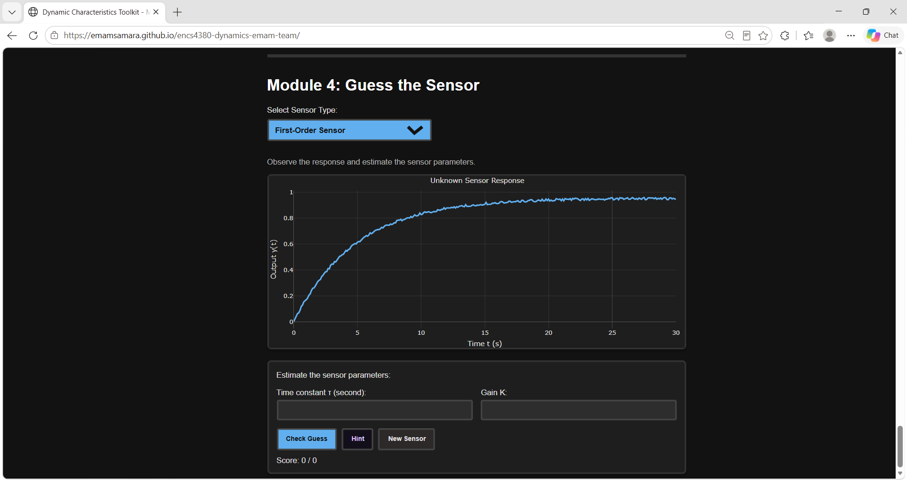

# Dynamic Characteristics Toolkit

ENCS4380 — Interfacing Techniques

Birzeit University

An interactive web toolkit for exploring first-order and second-order
sensor dynamics. It includes time-response plots, frequency-response
analysis, state-space visualization, and a sensor parameter guessing game.

## Live Demo

[Open the Dynamic Characteristics Toolkit](https://emamsamara.github.io/encs4380-dynamics-emam-team/)

## Team and Contributions

| Name | Student ID | Contributions |
|---|---|---|
| Emam Samara | 1220022 | Module 1: first-order step and ramp responses, 63.2% and 95% response markers, ramp lag, steady-state error, and logarithmic error-fraction plot. |
| Mustafa Fayed | 1220814 | Module 2: input/output sine plots, amplitude ratio, phase lag, frequency-response plots, cutoff frequency, dynamic-error calculator, and superposition of sine waves (bonus). |
| Omar Khaldi | 1231465 | Module 3: second-order step responses, response characteristics, poles in the s-plane, state-space modelling, eigenvalues, and phase-plane visualization. |
| Fawzy Abu Kwaik | 1201151 | Module 4: randomized sensor challenges, parameter estimation, measurement noise, session scoring, hints, and guessed/true response overlays. |

## How to Run

### Online

Open the Live Demo link above. No installation is required.

### Locally

1. Clone or download this repository.
2. Open `index.html` in a web browser.
3. Use the controls to explore the modules.

An internet connection is required to load Plotly.js from its CDN.

## Validation

The toolkit includes checks against the following theoretical results:

| Check | Expected result |
|---|---|
| First-order step | 63.2% of the final value at τ and approximately 95% at 3τ |
| First-order sine: τ = 0.2 s, ω = 2 rad/s | Amplitude ratio ≈ 0.928 and phase lag ≈ 21.8° |
| Maximum 5% amplitude error at 100 Hz | Maximum τ ≈ 0.523 ms; phase lag at 50 Hz ≈ 9.3° |
| Second-order step: ζ = 0.5 | Overshoot ≈ 16.3% |
| Critically damped step: ζ = 1 | No overshoot |
| State-space model: m = 1, b = 2, k = 4 | Eigenvalues and poles: −1 ± j1.732 |

## Screenshots

### Module 1 — First-Order Time Response

### Module 2 — Frequency Response

### Module 2 (Bonus) — Superposition of Sine Waves 

### Module 3 — Second-Order Response

### Module 4 — Guess the Sensor

## Technologies

- HTML and CSS for the interface.
- JavaScript for calculations and interaction.
- Plotly.js for interactive plots.
- GitHub Pages for hosting.

## References

- ENCS4380 course slides on static and dynamic characteristics.
- State-space modelling course notes.
- [Plotly.js Documentation](https://plotly.com/javascript/)

## AI Disclosure

ChatGPT was used to explain mathematical concepts, guide implementation,
review code, suggest interface improvements, and assist with documentation.
Some code snippets were adapted from AI suggestions.

The team reviewed and tested the implementation and is responsible for
the submitted work.